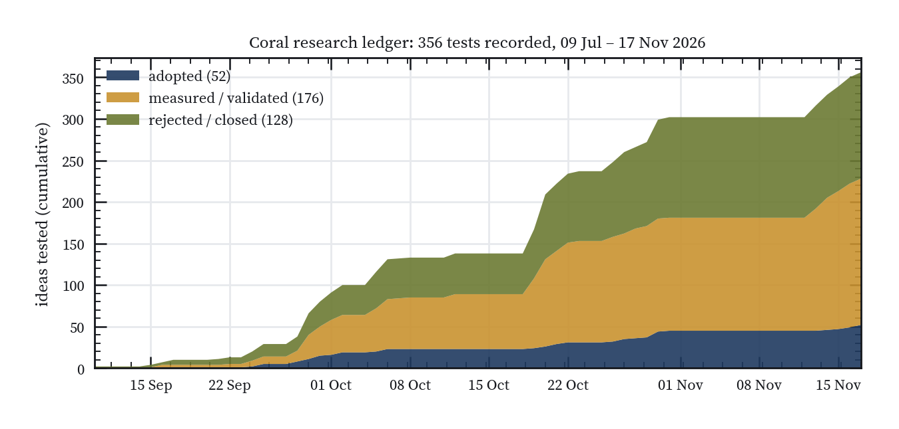
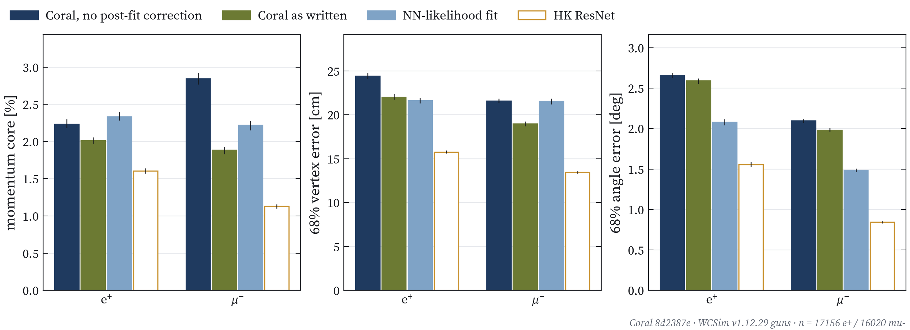
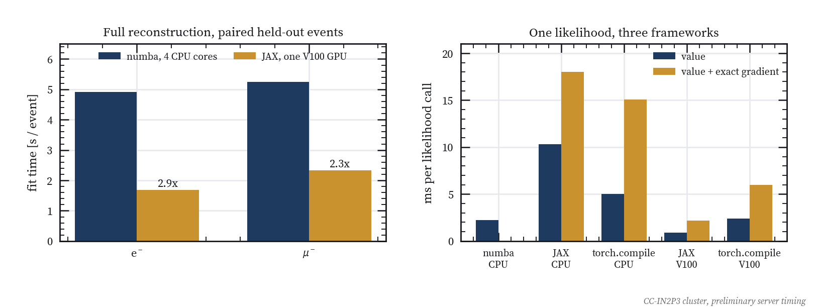
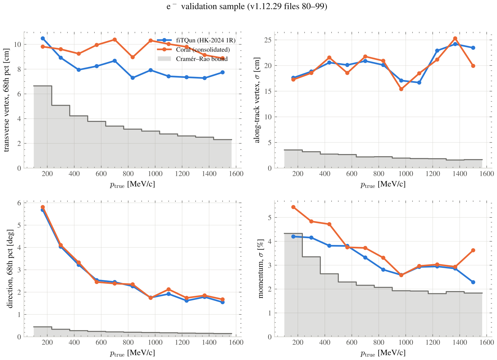

# Coral showcase: machine learning, GPU reconstruction and agent-assisted research for Hyper-Kamiokande

This repository collects my own contributions to **Coral**, the event reconstruction
for the [Hyper-Kamiokande](https://www.hyperk.org/) neutrino detector. The underlying
problem is an inverse problem. A charged particle crossing 260 kt of water emits a cone of
Cherenkov light, and ~20,000 photosensors (PMTs) record a ring of hits with charges and
times. From that pattern Coral infers the particle's vertex, direction, momentum and type,
by maximising a physics likelihood over every PMT. The detector's physics reach depends on
how precisely and how cheaply this is done, across millions of events.

Coral is a Python/numba reimplementation of **fiTQun**, the Super- and Hyper-Kamiokande
collaborations' reconstruction. fiTQun is collaboration-internal code, so **Coral's core
(its likelihood model and fitter) is not in this repository**. What is here is the work
that is not derived from fiTQun: the machine-learning extensions, the GPU/differentiable
backend (with the fiTQun-derived model redacted), the validation suite, and the
agent-assisted research setup that produced all of it.

## Projects

| | Project | In one line | Headline result (held-out simulation) |
|---|---|---|---|
| 1 | [**Post-fit ensemble**](post-fit-ensemble) | Learn each fit's error from how the electron and muon fits of the same event disagree, then correct it | e⁻ momentum resolution ×0.78, μ⁻ ×0.69; in Coral's production chain Oct–Nov 2026 |
| 2 | [**Learned per-PMT likelihood**](learned-likelihood) | Replace the analytic per-PMT likelihood with a neural density model and fit with it | direction −22 %, transverse vertex −29 % vs Coral's analytic likelihood; equal particle ID |
| 3 | [**Differentiable reconstruction on GPU**](differentiable-reco) | The likelihood in JAX: GPU fits, exact-Hessian uncertainties, a model correction trained *through* the fit | 2.3–2.9× faster per event on one GPU at equal accuracy |
| 4 | [**ML ring segmentation**](ml-ring-segmentation) | A segmentation network splits multi-particle events into rings, which Coral fits one by one | optional route to multi-ring events, ~1.7× faster than the full fit |
| 5 | [**Learned PMT selection**](learned-pmt-selection) | Rank PMTs by predicted importance to cut the likelihood's cost | rejected on evidence; a documented negative result |
| 6 | [**Sextant**](sextant) | Standalone validation and comparison suite: residuals, resolutions, PID, Cramér–Rao bounds, paired experiments | the instrument behind every number here |
| 7 | [**Agent-assisted research setup**](agentic-research) | The protocol, skills, guard hooks and research ledger used to run this work with an AI agent | 356 recorded tests, each against a criterion fixed in advance |

## Why this is relevant to the Lightcone fellowship

Most of the work above was done with an AI agent (Claude Code) as a research assistant,
under a protocol designed so that its results can be checked and built on:
- every idea gets a pass/kill criterion written to file **before** its result is seen;
- every cluster run freezes its code and config, so it can be reproduced;
- every verdict is a paired comparison on held-out events;
- every result, negative ones included, goes into a ledger that is checked before any new
  idea is proposed.

[`agentic-research/`](agentic-research) shows how this is enforced, and records what broke
along the way and the rules that followed.



## Selected results

**Ensemble and learned likelihood.** Each source alone (left to right in each group): Coral
without the post-fit correction, Coral with it, the learned-likelihood fit, and the HK
collaboration's ResNet for reference. The learned likelihood wins direction; the post-fit
correction wins momentum. Stacking them gains on both
([details](post-fit-ensemble)).



**GPU.** The same likelihood under numba, JAX and torch.compile, and full
reconstruction on one V100 against four CPU cores
([details](differentiable-reco)).



**Validation against the information limit.** Sextant compares reconstructions with each
other and with the Cramér–Rao bound computed from the likelihood itself. The gap shows how
much any better fitter could still gain ([details](sextant)).



## Layout and status

```
post-fit-ensemble/     coral/ (inference in Coral)  training/  stacking/
learned-likelihood/    networks, training and fitting scripts
differentiable-reco/   coral/ (JAX backend, model redacted; gradient fit)  studies/
ml-ring-segmentation/  Coral-side integration of the segmentation network
learned-pmt-selection/ selectors as in Coral + scans
sextant/               full source of the validation suite (its own README)
agentic-research/      CLAUDE.md protocol, skills/, hooks/, agents/, tools/, notes/
figures/
```

- Code is copied as it runs in the project. Scripts that import `fitqun*` modules call
  into Coral, which is not included, so they are here to be read, not run. Sextant's
  validation half runs standalone (`pip install -e sextant`). Its fiTQun probe (C++) is
  omitted.
- All results are on Hyper-K simulation (WCSim). Numbers in square brackets are 95 %
  confidence intervals from paired bootstrap; server timings are preliminary.
- Credits: the segmentation network is M. El Baz's and the HK ResNet is N. Prouse's
  (WatChMaL). Coral's core and fiTQun belong to the Hyper-K and Super-K collaborations.
- Shared for review only. No licence is granted.
