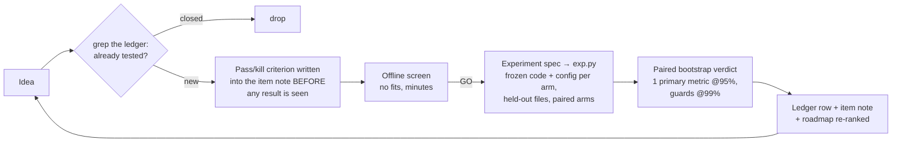
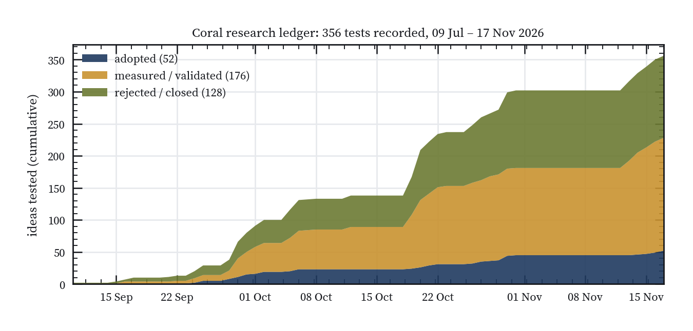

# Agent-assisted research setup

I run most of the Coral work with an AI agent (Claude Code) as a
research assistant. The agent writes code, submits cluster experiments, analyses them and
keeps the project's records. I set the direction and take every adoption decision. This
folder holds the setup that makes that safe, reproducible and cumulative. The main lesson
is that an agent's output is only as reliable as the instruments and protocol around it.

## Components

| Path | What it is |
|---|---|
| [`CLAUDE.md`](CLAUDE.md) | The standing protocol the agent reads every session: strategy, session routine, hard rules for experiments, the shared cluster, git, config files and delegation. Most rules there were written after a specific incident |
| [`skills/`](skills) | Reusable procedures: `experiment` (spec → submit → liveness check → merge → paired verdict → record), `offline-screen` (answer a question without a fit campaign, with a pre-registered GO bar), `bench` (same-node A/B timing), `profile`, `prepare-MR` (stacked merge requests, each validated against the one below it), `session-report` |
| [`hooks/`](hooks) | Guards that run before every shell command. They deny pushing to the collaboration's remote, mass job cancellation, multi-paragraph or attributed commit messages, and running submit scripts outside the frozen-run entry point. Tested by `test_bash_guard.py`. `settings.json` wires them in |
| [`agents/`](agents) | Two narrow sub-agents on cheaper models: `coral-coder` (implements a fully specified change) and `cluster-runner` (bulk log triage and merges) |
| [`tools/exp.py`](tools/exp.py) | The only entry point for cluster runs. It freezes code, config and parameters into an immutable run directory per arm, packs events per job from measured cost, caps a submission at 1000 jobs and cuts stragglers |
| [`tools/paired_verdict.py`](tools/paired_verdict.py) | Paired bootstrap comparison of two arms on the same events |
| [`tools/wt.py`](tools/wt.py), [`tools/reap_stragglers.py`](tools/reap_stragglers.py) | Git worktree slots (one per concurrent line of work), straggler handling |
| [`notes/ledger_excerpt.md`](notes/ledger_excerpt.md) | 18 of the 356 ledger rows: one row per idea ever tested, with verdict, key number and provenance |
| [`notes/method_traps_excerpt.md`](notes/method_traps_excerpt.md) | The index of "method traps": instrument failures that each produced a confident, plausible, wrong number, organised by the task you are about to do |
| [`notes/item_R54_*.md`](notes/item_R54_post_fit_estimator.md), [`item_R48_*.md`](notes/item_R48_learned_likelihood.md) | Working notes for two items, showing the criterion written before each result, then the result |
| [`example-spec/`](example-spec/r39_llc4_e.ini) | One experiment spec: three arms on the same held-out events |

## What I learned about doing science with an agent

- **Pre-register, in a file, before looking.** An agent will happily find the metric that
  passes. A November audit of the ledger found that the old rule ("no metric worse at
  95 %" over ~14 intervals) rejected half of all neutral changes. The rule became one
  primary metric at its 95 % CI, with the other metrics as guards at 99 %.
- **Record negative results as carefully as positive ones.** 128 of the 356 ideas were
  rejected or closed. The ledger is grepped before anything is proposed, so nothing closed
  is re-run.
- **Instruments fail silently.** Every method trap above crashed nothing and produced a
  believable number: one wrong truth join from a skipped event number, one stale local
  config in a timing comparison. Each became a rule, and where possible a tool check that
  fails loudly.
- **Put guardrails in code.** In September, 100 cold-starting jobs sharing one cache
  directory degraded the collaboration's shared filesystem. The rule that followed is
  in `CLAUDE.md`, and the dangerous commands are now blocked by hooks rather than by
  instructions.
- **Limit parallelism.** Fanning out many sub-agents exhausted the 5-hour usage limit in
  minutes, twice, so the project works with one helper at a time.
