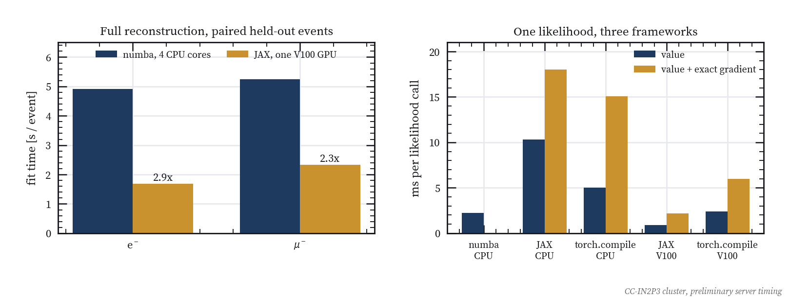

# Differentiable reconstruction on GPU (JAX)

Coral's likelihood is written once against a small array-backend shim, so the same code
runs under **JAX** (`jit`) and **PyTorch** (`torch.compile`) and is differentiable. It can
be differentiated with respect to the track parameters and, because every tuning table is
an argument, with respect to the model's own parameters. Four results came out of this
(all measured on held-out simulated events against the CPU production code):

1. **GPU reconstruction at equal accuracy.** JAX was chosen after a three-way benchmark;
   it agrees with the numba production likelihood to 1e-11. On one V100 it runs 2.9× (e⁻)
   and 2.3× (μ⁻) faster per event than numba on 4 CPU cores, with every resolution metric
   within its CI. Three engineering pieces make this work. Nelder–Mead is re-implemented as
   one on-device `lax.while_loop` program, so a fit step is a single dispatch. PMT sets are
   padded to size buckets, so a new event does not recompile. Executables are serialised
   ahead of time, so each cluster job skips re-tracing (2.45× wall time per job, start-up
   included).
2. **Per-event uncertainties from the exact Hessian** of the full-PMT likelihood. The predicted
   momentum error ranks events: the quarter of events with the largest predicted error has a
   residual spread of 7.8 %, against 2.4–3.6 % for the rest.
3. **A light-model correction trained through the fit.** A small MLP corrects the predicted
   light per PMT. It is trained by **implicit differentiation** through the fitted minimum,
   which is tracked by damped Newton, with a Huber loss on the fitted momentum, vertex and
   direction residuals. μ⁻ momentum core improved by −3.6 % [−6.2, −0.7] after calibration.
   The e⁻ gain turned out to be a calibration artefact. The project was closed because a
   simpler, non-ML fix to the same μ⁻ light-model error was adopted instead.
4. **Gradient-based multi-ring fits.** L-BFGS on the exact gradient, preconditioned by the
   diagonal curvature, after a loose simplex. The fits were accurate, but the method was
   rejected by its pre-registered speed bar. The offline analysis found why gradient methods
   stall on N-ring likelihoods: the hard arrival-order rule between rings makes the
   likelihood non-smooth.

## What is redacted

`coral/differentiable_backend.py` is the real module with the **physics model removed**.
The removed code covers predicted light, the charge and time pdfs, scattering, N-ring sums
and the table loaders, because it transcribes fiTQun, which is HK/SK collaboration code. What
remains is my own: the JAX/PyTorch backend shim, the learned model components (MLP light
correction, learned per-PMT term weights), size buckets, per-kind compilation (value,
value+gradient, Hessian), serialised AOT executables, and the on-device Nelder–Mead. The
model's entry points are stubs with their real signatures.

## Files

| Path | Role |
|---|---|
| `coral/differentiable_backend.py` | Backend shim, compilation and caching, on-device Nelder–Mead (model redacted) |
| `coral/gradient_fit.py` | L-BFGS-B fit on the exact gradient, with diagonal / full curvature preconditioning |
| `studies/train_llc.py` | Light correction v1–v3: maximum likelihood at the true track |
| `studies/train_llc_fit.py` | Light correction v4: trained through the fit by implicit differentiation |
| `studies/r39_pulls.py` | Hessian pulls against truth; whether σ ranks events |
| `studies/r55_hybrid.py` | Why gradient minimisers stall on the N-ring likelihood |
| `studies/bench_*.py`, `prof_1r.py`, `nm_test.py` | Framework benchmark, profiling, on-device Nelder–Mead parity with scipy |
