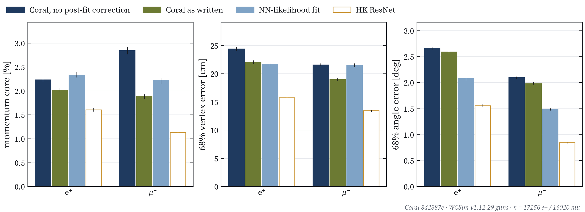

# Learned per-PMT likelihood

Coral's likelihood is analytic: for every PMT it predicts the light expected from a track,
then scores the observed charge and hit time against hand-built pdfs. This project
replaces that model with a neural network learned from simulation, keeping the fit
itself unchanged. The network's summed −log p over all ~20k PMTs is minimised with Nelder–Mead,
starting from Coral's own fit.

| Version | Model | Outcome |
|---|---|---|
| v1 | FreeDOM-style likelihood-ratio classifier: true track vs a track drawn from the prior, for each PMT | **Failed** its pre-registered bar: momentum core +143 %. Small per-PMT ratio errors add up over ~20k PMTs |
| v2 / v2b | Per-PMT **density** model trained by maximum likelihood: hit probability + 3-Gaussian mixtures for log charge and for the Cherenkov time residual, given the track geometry | **Passed** on 2432 held-out e⁻ against raw Coral: momentum core −11 %, vertex −11 %, transverse vertex −29 %, angle −22 %. e/μ PID equal (+0.2 [−1.7, +1.5] pt) |
| v3 | v2 + Coral's analytic light yield as an input (hybrid: analytic yield, learned shapes) | Passed, but weaker than v2b |
| v4 | Larger network | Used as a second source in the ensemble |

Against Coral's full production chain (fit + post-fit correction), the network fit is better
on direction (−21 % e⁻, −22 % μ⁻) and transverse vertex, but worse on momentum. Neither
fit was strictly better, so the next step was to stack the two:
[`../post-fit-ensemble`](../post-fit-ensemble), R54n. The training set is Coral's own hit
sets, dumped from its production runs, so the network learns the same hit selection the
fit sees.

*Single-ring guns, the same events for every source. "NN-likelihood fit" is v2b. The HK
ResNet is the collaboration's CNN, shown for reference.*

## Files

| Path | Role |
|---|---|
| `r48_lib.py` | Track–PMT geometry features, the v1 classifier and the v2 density network, per-PMT log p |
| `r48_split.py` | File-level train / validation split |
| `r48_train.py`, `r48_fit.py` | v1: train, then fit held-out events |
| `r48v2_train.py`, `r48v2_fit.py` | v2 density model |
| `r48v3_*.py`, `coral_mu.py` | v3 hybrid; `coral_mu.py` asks a frozen Coral checkout for its predicted light (a call only, no model code) |
| `r48v4_*.py` | v4 |
| `r48_pid.py`, `r48_analyse.py` | e/μ PID from the two networks; paired widths against Coral |
