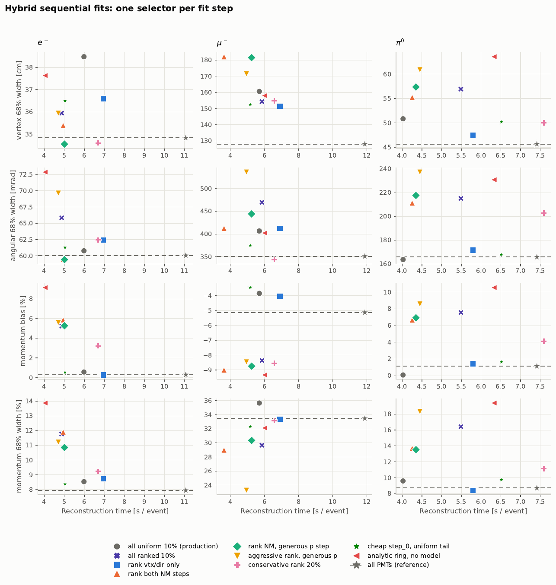

# Learned unhit-PMT selection (a documented negative result)

Most of the likelihood's cost goes on PMTs that saw no light. They outnumber the hit PMTs
about 5:1, and every one of the ~2000 likelihood evaluations in a fit recomputes them. Coral
kept a uniform stride of them. This project ranked them instead by predicted importance
(|ΔNLL| between the seed and the converged fit), using either a ring-distance proxy or a
gradient-boosted model over geometric features. The model is exported to plain arrays and
evaluated in numba, so neither xgboost nor torch is needed at run time.

What it found (report of 26 Aug 2026):
- The normalisation of the unhit term was the hard part, not the ranking. A naive weight
  biases the momentum by −54 % or +30 %. A per-event calibrated weight fixes this.
- Ranking wins on vertex and direction; the uniform stride wins on momentum. This is structural:
  the momentum is set by the *total* predicted light, which needs an unbiased sample.
- A hybrid sequential fit used a different selector in each fit step to exploit this.

The ranked selectors were **rejected**: none beat a uniform sample at equal cost on every
axis. A simpler rule, sampling by a predicted-charge threshold, was adopted instead.

| Path | Role |
|---|---|
| `pmt_selection.py` | The selectors as they live in Coral (ring proxy, GBM ranking in numba) |
| `export_pmt_selector_models.py` | Exports trained models to `.npz` |
| `run_pmt_selection_scan.py`, `run_pmt_hybrid_scan.py` | Selector × keep-fraction scans, and the hybrid sequential fit |
