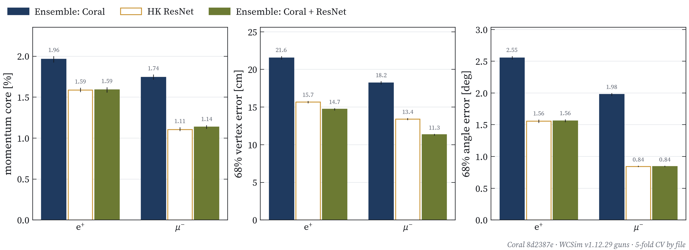

# Post-fit ensemble estimator

Coral fits every event twice, as an electron and as a muon. The two fits disagree in
ways that carry information: the ratio of their momenta, the shift between their vertices
and the difference in their likelihoods all say something about how wrong each fit is.
This project learns that mapping. Gradient-boosted trees, and later a blend of MLPs and
bagged GBMs, predict each fit's signed error from both fits: the log-momentum ratio, the
vertex offset in the track's own frame, and the direction tilt. The predicted error is
then subtracted from the fit. No momentum magnitude is used as input, so the model cannot
learn the training spectrum.

| Stage | What it adds | Held-out result |
|---|---|---|
| **R54**: Coral's two fits only | GBM on both hypotheses' fits, applied only where the fitted distance to the wall is at least a cut chosen by cross-validation | e⁻ momentum core 3.43 → 2.65 % (×0.775 [0.747, 0.806]), vertex −10 %; μ⁻ momentum ×0.69, vertex −11 %. In Coral's production chain 21 Oct to 14 Nov 2026 |
| **R54n**: stacked with the learned-likelihood fits ([`../learned-likelihood`](../learned-likelihood)) | adds the network fits of both hypotheses as inputs | against production: e⁻ vertex −12 %, angle −24 %; μ⁻ vertex −20 %, angle −32 % |
| **R54n3**: blend | 3 MLPs + a 5-seed bagged GBM, trained on one run, tested on a disjoint 190k-event validation run | e⁻ momentum core 2.01 → 1.94 %, μ⁻ 1.88 → 1.70 %, vertex −5 % / −8 %, every CI below zero |
| **+ HK ResNet** (the collaboration's CNN, N. Prouse) | the ResNet's vertex and momentum as an extra source | the ResNet alone beats every Coral-based fit; stacking Coral with it still narrows the vertex: e⁺ 15.7 → 14.7 cm, μ⁻ 13.4 → 11.3 cm |

Every row was judged against a pass criterion written down before the result was looked at
(see [`../agentic-research/notes/item_R54_post_fit_estimator.md`](../agentic-research/notes/item_R54_post_fit_estimator.md)),
with cross-validation grouped by input file and a final test on files no model had seen.
The first R54 version failed its own criterion: near the wall, some bins got worse. That
failure is why the version that was adopted applies the correction only where the fitted
distance to the wall clears a cut.

## Files

| Path | Role |
|---|---|
| `coral/post_fit.py` | Inference inside Coral. The trees are exported to plain arrays, so the cluster needs no sklearn |
| `training/post_fit_estimator_cv.py` | Feasibility study: features, targets, 5-fold CV by file |
| `training/r54_heldout.py`, `r54_v2.py` | Train once, freeze, apply to held-out files; v2 adds the wall cut |
| `training/r54_export.py` | Exports the fitted trees to `.npz` for `post_fit.py` |
| `stacking/r54n.py`, `r54n2.py`, `r54n3.py` | Stacking Coral with other sources; R54n3 is the MLP + bagged GBM blend |
| `stacking/r54n3_apply.py`, `r54n3_export.py` | Apply the blend to a full run, export it |
| `stacking/resnet_h5.py` | Converts WCSim events to the ResNet's HDF5 input (trigger-0 digits, raw times, 0-based PMT ids) |

These scripts read Coral's ROOT output and simulation truth. They run against the
collaboration's data and are not runnable standalone.
